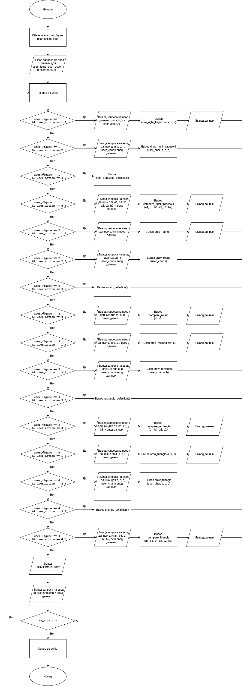

# Домашнее задание к работе 10

## Условие задачи
Составьте программу, которая для заданной пользователем фигуры, например прямоугольника (треугольника или другой фигуры см. инидивидуальное задание работы 9) предлагает меню выбора одной из операций:
1) рассчитать площадь;
2) вывести определение фигуры;
3) нарисовать фигуру.


Для каждой из операций и фигур реализуйте одну собственную функцию вычисления площади с необходимым числом параметров, например :


float area_round( float a); // для круга

float area_rectangle( float a, float b); // для прямоугольника

float area_triangle( float a, float b, float c); // для треугольника


и рисования  фигуры символом '*' (размеры сторон фигуры пользователь задает в main):


void draw_rectangle( int a, int b);


или рисования  фигуры (вид символа пользователь задает в main):


void draw_round( char a);

    Для вывода параметров фигуры:

int get_radius(); // возвращает радиус круга

    Для сравнения двух фигур по площади

int compare_round (int a, int b)// возвращает разницу между двумя кругами с радиусами a и b


## 1. Алгоритм и блок-схема

### Алгоритм
1. **Начало**
2. Объявление переменных
   - int `user_figure` - выбор пользователем фигуры
   - int `user_action` - выбор пользователем действия с фигурой
   - int `stop` - выбор пользователем остановки или продолжения программы
3. Начало конструкции do-while
4. Вывод запроса ввода значений для `user_figure`, `user_action`
5. Ввод данных пользователем
6. Выбор действия, осуществленный через if, else if и else
   - if (`user_figure` == 1 && `user_action` == 1): Запрос ввода данных, ввод данных, вызов функции area_right_trapezoid()
   - else if (`user_figure` == 1 && `user_action` == 2): Запрос ввода данных, ввод данных, вызов функции draw_right_trapezoid()
   - else if (`user_figure` == 1 && `user_action` == 3): Запрос ввода данных, ввод данных, вызов функции right_trapezoid_definition()
   - else if (`user_figure` == 1 && `user_action` == 4): Запрос ввода данных, ввод данных, вызов функции compare_right_trapezoid()
   - if (`user_figure` == 2 && `user_action` == 1): Запрос ввода данных, ввод данных, вызов функции area_round()
   - else if (`user_figure` == 2 && `user_action` == 2): Запрос ввода данных, ввод данных, вызов функции draw_round()
   - else if (`user_figure` == 2 && `user_action` == 3): Запрос ввода данных, ввод данных, вызов функции round_definition()
   - else if (`user_figure` == 2 && `user_action` == 4): Запрос ввода данных, ввод данных, вызов функции compare_round()
   - if (`user_figure` == 3 && `user_action` == 1): Запрос ввода данных, ввод данных, вызов функции area_rectangle()
   - else if (`user_figure` == 3 && `user_action` == 2): Запрос ввода данных, ввод данных, вызов функции draw_rectangle()
   - else if (`user_figure` == 3 && `user_action` == 3): Запрос ввода данных, ввод данных, вызов функции rectangle_definition()
   - else if (`user_figure` == 3 && `user_action` == 4): Запрос ввода данных, ввод данных, вызов функции compare_rectangle()
   - if (`user_figure` == 4 && `user_action` == 1): Запрос ввода данных, ввод данных, вызов функции area_triangle()
   - else if (`user_figure` == 4 && `user_action` == 2): Запрос ввода данных, ввод данных, вызов функции draw_triangle()
   - else if (`user_figure` == 4 && `user_action` == 3): Запрос ввода данных, ввод данных, вызов функции triangle_definition()
   - else if (`user_figure` == 4 && `user_action` == 4): Запрос ввода данных, ввод данных, вызов функции compare_triangle()
   - else: Вывод строки "Такой команды нет"
7. Запрос ввода данных для `stop`
8. Ввод данных для `stop`
9. Конец конструкции do-while
10. **Конец**

### Блок-схема
 

## 2. Реализация программы

```
#define _USE_MATH_DEFINES
#define _CRT_SECURE_NO_WARNINGS
#include <stdio.h>
#include <locale.h>
#include <math.h>

float area_right_trapezoid(float a, float b, float h); //Площадь прямоугольной трапеции
float area_round(float r); //Площадь круга
float area_rectangle(float a, float b); //Площадь прямоугольника
float area_triangle(float a, float b, float c); //Площадь треугольника
void draw_right_trapezoid(char user_char, int a, int b, int h); //Нарисовать прямоугольную трапецию
void draw_round(char user_char, int r); //Нарисовать круг
void draw_rectangle(char user_char, int a, int b); //Нарисовать прямоугольник
void draw_triangle(char user_char, int a, int b, int c); //Нарисовать треугольник
void right_trapezoid_definition(); //Определение прямоугольной трапеции
void round_definition(); //Определение круга
void rectangle_definition(); //Определение прямоугольника
void triangle_definition(); //Определение треугольника
float compare_round(float r1, float r2); //Определение разницы площадей двух кругов
float compare_rectangle(float a1, float b1, float a2, float b2); //Определение разницы площадей двух прямоугольников
float compare_triangle(float a1, float b1, float c1, float a2, float b2, float c2); //Определение разницы площадей двух треугольников
float compare_right_trapezoid(float a1, float b1, float h1, float a2, float b2, float h2); //Определение разницы площадей двух прямоугольных трапеций

int main() {
	int user_figure, user_action, stop;


	setlocale(LC_CTYPE, "RUS");

	do {
		printf("Выберите фигуру: (1 - Прямоугольная трапеция, 2 - Круг, 3 - Прямоугольник, 4 - Треугольник): ");
		scanf("%d", &user_figure);
		printf("\n");
		printf("Выберите действие: (1 - Найти площадь, 2 - Нарисовать фигуру, 3 - Вывести определение фигуры, 4 - Сравнить площади двух фигур): ");
		scanf("%d", &user_action);
		printf("\n");

		//Трапеция
		if (user_figure == 1 && user_action == 1) {
			float a, b, h;

			printf("Введите основания a, b и высоту h: ");
			scanf("%f %f %f", &a, &b, &h);
			printf("\n");
			printf("%f", area_right_trapezoid(a, b, h));
			printf("\n");
		}

		else if (user_figure == 1 && user_action == 2) {
			int a, b, h;
			char user_char;

			printf("Введите символ: ");
			scanf(" %c", &user_char);
			printf("\n");
			printf("Введите целочисленные основания a, b и высоту h: ");
			scanf("%d %d %d", &a, &b, &h);
			printf("\n");
			draw_right_trapezoid(user_char, a, b, h);
			printf("\n");
		}

		else if (user_figure == 1 && user_action == 3) {
			right_trapezoid_definition();
			printf("\n");
		}

		else if (user_figure == 1 && user_action == 4) {
			float a1, b1, h1, a2, b2, h2;

			printf("Введите основания a, b и высоту h для первой фигуры: ");
			scanf("%f %f %f", &a1, &b1, &h1);
			printf("\n");
			printf("Введите основания a, b и высоту h для второй фигуры: ");
			scanf("%f %f %f", &a2, &b2, &h2);
			printf("\n");
			printf("%f", compare_right_trapezoid(a1, b1, h1, a2, b2, h2));
			printf("\n");
		}

		//Круг
		else if (user_figure == 2 && user_action == 1) {
			float r;

			printf("Введите радиус r: ");
			scanf("%f", &r);
			printf("\n");
			printf("%f", area_round(r));
			printf("\n");
		}

		else if (user_figure == 2 && user_action == 2) {
			int r;
			char user_char;

			printf("Введите символ: ");
			scanf(" %c", &user_char);
			printf("\n");
			printf("Введите целочисленный радиус r: ");
			scanf("%d", &r);
			printf("\n");
			draw_round(user_char, r);
			printf("\n");
		}

		else if (user_figure == 2 && user_action == 3) {
			round_definition();
			printf("\n");
		}

		else if (user_figure == 2 && user_action == 4) {
			float r1, r2;

			printf("Введите радиус r для первой фигуры: ");
			scanf("%f", &r1);
			printf("\n");
			printf("Введите радиус r для второй фигуры: ");
			scanf("%f", &r2);
			printf("\n");
			printf("%f", compare_round(r1, r2));
			printf("\n");
		}


		//Прямоугольник
		else if (user_figure == 3 && user_action == 1) {
			float a, b;

			printf("Введите стороны a, b : ");
			scanf("%f %f", &a, &b);
			printf("\n");
			printf("%f", area_rectangle(a, b));
			printf("\n");
		}

		else if (user_figure == 3 && user_action == 2) {
			int a, b;
			char user_char;

			printf("Введите символ: ");
			scanf(" %c", &user_char);
			printf("\n");
			printf("Введите целочисленные стороны a, b: ");
			scanf("%d %d", &a, &b);
			printf("\n");
			draw_rectangle(user_char, a, b);
			printf("\n");
		}

		else if (user_figure == 3 && user_action == 3) {
			rectangle_definition();
			printf("\n");
		}

		else if (user_figure == 3 && user_action == 4) {
			float a1, b1, a2, b2;

			printf("Введите стороны a, b для первой фигуры: ");
			scanf("%f %f", &a1, &b1);
			printf("\n");
			printf("Введите стороны a, b для второй фигуры: ");
			scanf("%f %f", &a2, &b2);
			printf("\n");
			printf("%f", compare_rectangle(a1, b1, a2, b2));
			printf("\n");
		}


		//Треугольник
		else if (user_figure == 4 && user_action == 1) {
			float a, b, c;

			printf("Введите стороны a, b и основание c: ");
			scanf("%f %f %f", &a, &b, &c);
			printf("\n");
			printf("%f", area_triangle(a, b, c));
			printf("\n");
		}

		else if (user_figure == 4 && user_action == 2) {
			int a, b, c;
			char user_char;

			printf("Введите символ: ");
			scanf(" %c", &user_char);
			printf("\n");
			printf("Введите целочисленные стороны a, b и основание c: ");
			scanf("%d %d %d", &a, &b, &c);
			printf("\n");
			draw_triangle(user_char, a, b, c);
			printf("\n");
		}

		else if (user_figure == 4 && user_action == 3) {
			triangle_definition();
			printf("\n");
		}

		else if (user_figure == 4 && user_action == 4) {
			float a1, b1, c1, a2, b2, c2;

			printf("Введите стороны a, b и основание c для первой фигуры: ");
			scanf("%f %f %f", &a1, &b1, &c1);
			printf("\n");
			printf("Введите стороны a, b и основание c для второй фигуры: ");
			scanf("%f %f %f", &a2, &b2, &c2);
			printf("\n");
			printf("%f", compare_triangle(a1, b1, c1, a2, b2, c2));
			printf("\n");
		}

		else printf("Такой команды нет\n");

		printf("Продолжить? (1 - да, 0 - нет): ");
		scanf("%d", &stop);
		printf("\n");
	}
	while (stop != 0);

	return 0;
}

//Определение прямоугольной трапеции
void right_trapezoid_definition() {
	printf("Прямоугольная трапеция — это четырехугольник (трапеция), у которого один из углов между основанием и боковой стороной равен 90° (прямой угол).");
}

//Определение круга
void round_definition() {
	printf("Круг — это геометрическая фигура, представляющая собой часть плоскости, ограниченную окружностью.");
}

//Определение прямоугольника
void rectangle_definition() {
	printf("Прямоугольник — это четырёхугольник, у которого все внутренние углы прямые (каждый равен 90°).");
}

//Определение треугольника
void triangle_definition() {
	printf("Треугольник — это базовая геометрическая фигура, которая состоит из трех точек (называемых вершинами), не лежащих на одной прямой, и трех отрезков (называемых сторонами), попарно соединяющих эти точки.");
}

//Площадь прямоугольной трапеции
float area_right_trapezoid(float a, float b, float h) {
	float res;

	res = (a + b) / 2.0 * h;

	return res;
}

//Площадь круга
float area_round(float r) {
	float res;

	res = M_PI * r * r;

	return res;
}

//Площадь прямоугольника
float area_rectangle(float a, float b) {
	float res;

	res = a * b;

	return res;
}

//Площадь треугольника
float area_triangle(float a, float b, float c) {
	float res, p;

	p = (a + b + c) / 2;
	res = sqrt(p * (p - a) * (p - b) * (p - c));

	return res;
}

//Определение разницы площадей двух прямоугольных трапеций
float compare_right_trapezoid(float a1, float b1, float h1, float a2, float b2, float h2) {
	float res1, res2, res;

	res1 = area_right_trapezoid(a1, b1, h1);
	res2 = area_right_trapezoid(a2, b2, h2);
	res = fabs(res1 - res2);

	return res;
}

//Определение разницы площадей двух кругов
float compare_round(float r1, float r2) {
	float res1, res2, res;

	res1 = area_round(r1);
	res2 = area_round(r2);
	res = fabs(res1 - res2);

	return res;
}

//Определение разницы площадей двух прямоугольников
float compare_rectangle(float a1, float b1, float a2, float b2) {
	float res1, res2, res;

	res1 = area_rectangle(a1, b1);
	res2 = area_rectangle(a2, b2);
	res = fabs(res1 - res2);

	return res;
}

//Определение разницы площадей двух треугольников
float compare_triangle(float a1, float b1, float c1, float a2, float b2, float c2) {
	float res1, res2, res;

	res1 = area_triangle(a1, b1, c1);
	res2 = area_triangle(a2, b2, c2);
	res = fabs(res1 - res2);

	return res;
}

//Нарисовать прямоугольную трапецию
void draw_right_trapezoid(char user_char, int a, int b, int h) {
	int offset, c, max, min;

	if (a > b) { max = a; min = b; }
	else { max = b; min = a; }

	offset = round((max - min) / (float)(h - 1));

	c = min;

	for (int temp1 = 1; temp1 <= h; temp1++) {

		for (int temp2 = 1; temp2 <= max; temp2++) {

			if (((temp1 == 1) && temp2 <= min) || (temp1 == h)) printf("%c", user_char);
			else
				if (temp2 == c || temp2 == 1) printf("%c", user_char);
				else printf(" ");

		}

		c += offset;

		printf("\n");
	}

}

//Нарисовать круг
void draw_round(char user_char, int r) {
	int left_edge, right_edge, h;
	
	h = r * 2 + 1;
	left_edge = r + 1;
	right_edge = r + 1;

	for (int temp1 = 1; temp1 <= h; temp1++) {

		for (int temp2 = 1; temp2 <= h; temp2++) {

			if (temp2 == left_edge || temp2 == right_edge) printf("%c", user_char);
			else printf(" ");

		}

		if (temp1 <= r) {
			left_edge -= 1;
			right_edge += 1;
		}
		else {
			left_edge += 1;
			right_edge -= 1;
		}

		printf("\n");
	}

}

//Нарисовать прямоугольник
void draw_rectangle(char user_char, int a, int b){

	for (int temp1 = 1; temp1 <= a; temp1++) {

		for (int temp2 = 1; temp2 <= b; temp2++) {

			if (temp1 == 1 || temp1 == a) printf("%c", user_char);
			else {
				if (temp2 == 1 || temp2 == b) printf("%c", user_char);
				else printf(" ");

			}
		}

		printf("\n");
	}

}

//Нарисовать треугольник
void draw_triangle(char user_char, int a, int b, int c) {
	int h, left_edge, right_edge, offset;

	h = area_triangle(a, b, c) * 2 / c;
	left_edge = (c + 1)/ 2;
	right_edge = (c + 1) / 2;
	offset = round((c - 1) / 2.0 / (float)(h - 1));

	for (int temp1 = 1; temp1 <= h; temp1++) {
		
		for (int temp2 = 1; temp2 <= c; temp2++) {
			
			if (temp1 == h) printf("%c", user_char);
			else {
				if (temp2 == left_edge || temp2 == right_edge) printf("%c", user_char);
				else printf(" ");

			}
		}

		left_edge -= offset;
		right_edge += offset;

		printf("\n");
	}

}
```

## 3. Результаты работы программы

1. **Вывод программы для каждой фигуры и каждого действия с ней, показана интерактивность программы**
```
Выберите фигуру: (1 - Прямоугольная трапеция, 2 - Круг, 3 - Прямоугольник, 4 - Треугольник): 1

Выберите действие: (1 - Найти площадь, 2 - Нарисовать фигуру, 3 - Вывести определение фигуры, 4 - Сравнить площади двух фигур): 1

Введите основания a, b и высоту h: 6 4 5

25.000000
Продолжить? (1 - да, 0 - нет): 1

Выберите фигуру: (1 - Прямоугольная трапеция, 2 - Круг, 3 - Прямоугольник, 4 - Треугольник): 1

Выберите действие: (1 - Найти площадь, 2 - Нарисовать фигуру, 3 - Вывести определение фигуры, 4 - Сравнить площади двух фигур): 2

Введите символ: *

Введите целочисленные основания a, b и высоту h: 8 4 5

****
*   *
*    *
*     *
********

Продолжить? (1 - да, 0 - нет): 1

Выберите фигуру: (1 - Прямоугольная трапеция, 2 - Круг, 3 - Прямоугольник, 4 - Треугольник): 1

Выберите действие: (1 - Найти площадь, 2 - Нарисовать фигуру, 3 - Вывести определение фигуры, 4 - Сравнить площади двух фигур): 3

Прямоугольная трапеция - это четырехугольник (трапеция), у которого один из углов между основанием и боковой стороной равен 90° (прямой угол).
Продолжить? (1 - да, 0 - нет): 1

Выберите фигуру: (1 - Прямоугольная трапеция, 2 - Круг, 3 - Прямоугольник, 4 - Треугольник): 1

Выберите действие: (1 - Найти площадь, 2 - Нарисовать фигуру, 3 - Вывести определение фигуры, 4 - Сравнить площади двух фигур): 4

Введите основания a, b и высоту h для первой фигуры: 6 4 5

Введите основания a, b и высоту h для второй фигуры: 2 2 5

15.000000
Продолжить? (1 - да, 0 - нет): 1

Выберите фигуру: (1 - Прямоугольная трапеция, 2 - Круг, 3 - Прямоугольник, 4 - Треугольник): 2

Выберите действие: (1 - Найти площадь, 2 - Нарисовать фигуру, 3 - Вывести определение фигуры, 4 - Сравнить площади двух фигур): 5

Такой команды нет
Продолжить? (1 - да, 0 - нет): 1

Выберите фигуру: (1 - Прямоугольная трапеция, 2 - Круг, 3 - Прямоугольник, 4 - Треугольник): 2

Выберите действие: (1 - Найти площадь, 2 - Нарисовать фигуру, 3 - Вывести определение фигуры, 4 - Сравнить площади двух фигур): 1

Введите радиус r: 5

78.539818
Продолжить? (1 - да, 0 - нет): 1

Выберите фигуру: (1 - Прямоугольная трапеция, 2 - Круг, 3 - Прямоугольник, 4 - Треугольник): 2

Выберите действие: (1 - Найти площадь, 2 - Нарисовать фигуру, 3 - Вывести определение фигуры, 4 - Сравнить площади двух фигур): 2

Введите символ: +

Введите целочисленный радиус r: 8

        +
       + +
      +   +
     +     +
    +       +
   +         +
  +           +
 +             +
+               +
 +             +
  +           +
   +         +
    +       +
     +     +
      +   +
       + +
        +

Продолжить? (1 - да, 0 - нет): 1

Выберите фигуру: (1 - Прямоугольная трапеция, 2 - Круг, 3 - Прямоугольник, 4 - Треугольник): 2

Выберите действие: (1 - Найти площадь, 2 - Нарисовать фигуру, 3 - Вывести определение фигуры, 4 - Сравнить площади двух фигур): 3

Круг - это геометрическая фигура, представляющая собой часть плоскости, ограниченную окружностью.
Продолжить? (1 - да, 0 - нет): 1

Выберите фигуру: (1 - Прямоугольная трапеция, 2 - Круг, 3 - Прямоугольник, 4 - Треугольник): 2

Выберите действие: (1 - Найти площадь, 2 - Нарисовать фигуру, 3 - Вывести определение фигуры, 4 - Сравнить площади двух фигур): 4

Введите радиус r для первой фигуры: 5

Введите радиус r для второй фигуры: 3

50.265484
Продолжить? (1 - да, 0 - нет): 1

Выберите фигуру: (1 - Прямоугольная трапеция, 2 - Круг, 3 - Прямоугольник, 4 - Треугольник): 3

Выберите действие: (1 - Найти площадь, 2 - Нарисовать фигуру, 3 - Вывести определение фигуры, 4 - Сравнить площади двух фигур): 1

Введите стороны a, b : 4 10

40.000000
Продолжить? (1 - да, 0 - нет): 1

Выберите фигуру: (1 - Прямоугольная трапеция, 2 - Круг, 3 - Прямоугольник, 4 - Треугольник): 3

Выберите действие: (1 - Найти площадь, 2 - Нарисовать фигуру, 3 - Вывести определение фигуры, 4 - Сравнить площади двух фигур): 2

Введите символ: #

Введите целочисленные стороны a, b: 7 15

###############
#             #
#             #
#             #
#             #
#             #
###############

Продолжить? (1 - да, 0 - нет): 1

Выберите фигуру: (1 - Прямоугольная трапеция, 2 - Круг, 3 - Прямоугольник, 4 - Треугольник): 3

Выберите действие: (1 - Найти площадь, 2 - Нарисовать фигуру, 3 - Вывести определение фигуры, 4 - Сравнить площади двух фигур): 3

Прямоугольник - это четырёхугольник, у которого все внутренние углы прямые (каждый равен 90°).
Продолжить? (1 - да, 0 - нет): 1

Выберите фигуру: (1 - Прямоугольная трапеция, 2 - Круг, 3 - Прямоугольник, 4 - Треугольник): 3

Выберите действие: (1 - Найти площадь, 2 - Нарисовать фигуру, 3 - Вывести определение фигуры, 4 - Сравнить площади двух фигур): 4

Введите стороны a, b для первой фигуры: 5 8

Введите стороны a, b для второй фигуры: 3 3

31.000000
Продолжить? (1 - да, 0 - нет): 1

Выберите фигуру: (1 - Прямоугольная трапеция, 2 - Круг, 3 - Прямоугольник, 4 - Треугольник): 4

Выберите действие: (1 - Найти площадь, 2 - Нарисовать фигуру, 3 - Вывести определение фигуры, 4 - Сравнить площади двух фигур): 1

Введите стороны a, b и основание c: 3 4 5

6.000000
Продолжить? (1 - да, 0 - нет): 1

Выберите фигуру: (1 - Прямоугольная трапеция, 2 - Круг, 3 - Прямоугольник, 4 - Треугольник): 4

Выберите действие: (1 - Найти площадь, 2 - Нарисовать фигуру, 3 - Вывести определение фигуры, 4 - Сравнить площади двух фигур): 2

Введите символ: ?

Введите целочисленные стороны a, b и основание c: 6 5 5

  ?
 ? ?
?   ?
?????

Продолжить? (1 - да, 0 - нет): 1

Выберите фигуру: (1 - Прямоугольная трапеция, 2 - Круг, 3 - Прямоугольник, 4 - Треугольник): 4

Выберите действие: (1 - Найти площадь, 2 - Нарисовать фигуру, 3 - Вывести определение фигуры, 4 - Сравнить площади двух фигур): 3

Треугольник - это базовая геометрическая фигура, которая состоит из трех точек (называемых вершинами), не лежащих на одной прямой, и трех отрезков (называемых сторонами), попарно соединяющих эти точки.
Продолжить? (1 - да, 0 - нет): 1

Выберите фигуру: (1 - Прямоугольная трапеция, 2 - Круг, 3 - Прямоугольник, 4 - Треугольник): 4

Выберите действие: (1 - Найти площадь, 2 - Нарисовать фигуру, 3 - Вывести определение фигуры, 4 - Сравнить площади двух фигур): 4

Введите стороны a, b и основание c для первой фигуры: 3 4 5

Введите стороны a, b и основание c для второй фигуры: 5 5 6

6.000000
Продолжить? (1 - да, 0 - нет): 0
```

## 4. Информация о разработчике

Лупачев Сергей бТИИ-262
